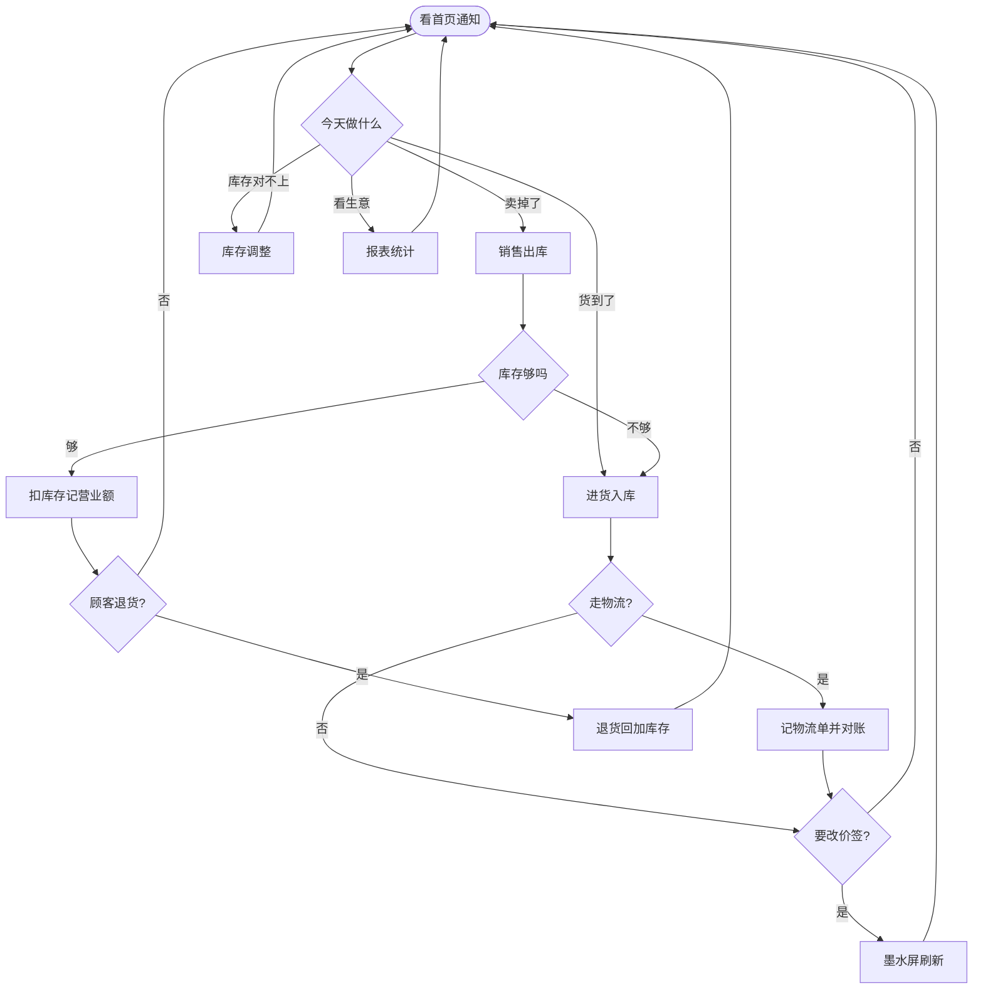

# 商品管理系统 · 用户操作手册

> 适用对象：便利店 / 快消门店试用人员  
> 系统用途：管商品、管库存、记进货、记销售、对物流账、看经营数据，并给货架墨水屏同步价签信息。

本手册按「平时怎么用」来写。你不需要懂技术，只要会打开网页、点按钮、填表单即可。

---

## 1. 先看一眼：系统能帮你做什么

把系统理解成店铺的进销存台账：

| 你想做的事 | 去哪个菜单 |
| --- | --- |
| 看今天生意怎么样、有没有库存告急 | 首页（数据总览） |
| 建商品档案、改售价 | 商品信息 |
| 把饮料、零食等分好类 | 商品分类 |
| 登记供货厂家 | 供应商 |
| 货到了，把数量加进库存 | 进货入库 |
| 盘点、损耗、看库存怎么变的 | 库存流水 |
| 卖出去了，扣库存 | 销售出库 |
| 登记快递公司 / 物流公司 | 物流商 |
| 记运费、对账、结清 | 物流对账 |
| 货架电子价签绑商品、刷新价格 | 墨水屏 |
| 看一段时间卖了多少、进了多少 | 报表统计 |
| 设置库存什么时候算「快没货了」 | 业务设置 |

**建议的做事顺序（第一次用尤其重要）：**

分类 → 供应商 → 商品 → 进货入库 → 销售出库 → 看首页和报表

分类、厂家没建好，后面新建商品时会选不到。

### 操作流程图

第一次使用，按这条线把基础资料建齐：

建好之后，每天从首页出发，按当时要做的事往下走：

进货、销售都是**一种商品一张单**。进错了去进货台账点「作废」，卖错了去销售出库点「退货」，不要再录一笔负数。

---

## 2. 登录和界面

### 2.1 怎么登录

1. 用电脑打开试用人员给你的网址。
2. 输入账号、密码。
3. 如果出现验证码，按右侧图片输入；看不清就点图片换一张。
4. 可勾选「记住密码」，下次少填一遍。
5. 点 **登录**。

登录成功后进入首页。左侧是功能菜单，上方是当前打开的页面标签。

> 账号由管理员发放。如果登录后左侧菜单很少，是权限不够，请联系管理员开通，不是系统坏了。

### 2.2 界面上这些按钮是什么意思

多数列表页都长得差不多：

- **搜索 / 查询**：按条件筛选
- **重置**：清空筛选条件，重新显示全部
- **新增**：打开填写窗口
- **导出**：下载 Excel，方便打印或发给别人
- **分页**：底部分页器可换页、改每页条数

右上角头像可以：

- **个人中心**：改姓名、手机、邮箱，以及修改密码
- **锁定屏幕**：临时离开时锁住页面
- **退出登录**：用完请退出，尤其是公共电脑

---

## 3. 第一次开张：把基础资料建好

下面按推荐顺序操作。做完这一章，日常进货、卖货才能顺利点下去。

### 3.1 商品分类

菜单：**商品分类**

分类用来给商品归堆，例如「饮料」「零食」「日用品」。报表、商品筛选都会用到。

**新增分类：**

1. 点 **新增**。
2. 填写分类名称（必填）。
3. 「显示顺序」数字越小越靠前，可以先填 `1、2、3`。
4. 状态选 **正常**。
5. 点 **确定**。

暂时不用的分类，改成 **停用** 即可，不要急着删除。删除前请确认没有商品还在用这个分类。

### 3.2 供应商

菜单：**供应商**

供应商就是给你供货的厂家或批发商。

**新增供应商：**

1. 点 **新增**。
2. 填供应商名称、联系人、联系电话（这三项都要填）。
3. 状态选 **正常**。
4. 点 **确定**。

列表里的开关可以随时停用某家供应商。停用后，它不再出现在「正常合作」里，新建商品、进货时也尽量不要再选它。

点供应商名称或 **查看**，可以看到这家厂子供了哪些商品、有过哪些进货记录。

### 3.3 商品信息

菜单：**商品信息**

这是档案本。每个要卖的货都要先建一条商品。

页面上方四个数字卡片能快速看到：商品总数、库存预警件数、零库存件数、离线墨水屏台数。

**新增一件商品：**

1. 点 **新增商品**。
2. 必填项：
   - 商品名称
   - 商品规格（例如 `330ml×24罐/箱` 或 `500g/袋`）
   - 分类
   - 进价、售价
   - 库存（刚建档时可以先填 `0`，等进货时再加）
   - 进货厂家
3. 商品编号可以留空，系统会自动生成。
4. 简介、备注选填。简介以后可以显示在墨水屏上。
5. 点 **确定**。

**改价格或资料：** 点该行 **编辑**，改完确定即可。

**找货、看缺货：**

- 可用商品名称、分类、进货厂家搜索。
- 点 **库存预警** / **零库存**，只看快没货或已经没货的商品。库存数字会标颜色：正常、预警、无库存。

**一批商品一起改分类或厂家：**

1. 勾选多件商品。
2. 点上方 **批量编辑**。
3. 只填要改的项，不改的留空。
4. 确定。

**用 Excel 一次性导入：**

1. 点 **导入**。
2. 先点 **下载模板**，按表格填好（不要改表头）。
3. 把填好的文件拖进窗口，或点击上传。
4. 如果表格里是已经存在的商品，需要勾选「是否更新已经存在的商品」。系统按 **商品编号**，或者 **名称 + 规格** 来匹配。
5. 只支持 `.xls` / `.xlsx`。点确定后看提示是否成功。

**删除商品请谨慎。** 已经有进货、销售记录的商品，不建议删，以免对不上账。

---

## 4. 日常进货：货到了怎么记账

菜单：**进货入库**（和「库存流水」其实是同一页的两个标签）

进货的作用：记下「哪天、从哪家、进了什么、进了多少、花了多少钱」，同时把库存加上去。

**注意：目前一张进货单只能记一种商品。** 一次到了 10 种货，就录 10 张进货单。

### 4.1 新增进货

1. 确认当前是 **进货台账** 标签。
2. 点 **新增进货**。
3. 选择商品（可输入关键字搜索）。规格和当前库存会自动带出，不用填。
4. 填进货数量、单品进价。本次金额会自动算出来。
5. 选择供货厂家、进货日期。
6. 备注可选，例如「活动进货」或「破损补货」。
7. 点 **确定**。

成功后：

- 商品库存会增加
- 进货台账多一条记录，状态为「正常」
- 库存流水里会多一条「入库」记录

可用商品名称、厂家、状态、时间（本月 / 上月 / 全部 / 自定义）筛选。点 **导出** 可下载台账。

### 4.2 进错了怎么办：作废

进货单录错数量、录错商品，不要再录一张「负数进货」，直接作废。

1. 在进货台账找到那张单。
2. 点 **作废**。
3. 确认提示：系统会把当时加上去的库存减回去。

作废后的单子会显示「作废」，不能再作废一次。库存流水里会出现一条「作废」记录，方便以后对账。

> 已经卖掉一部分的货，作废进货可能导致库存被减成不合理的数字。这种情况先问清楚再点。

---

## 5. 库存对不上：怎么盘点、记损耗

菜单：**库存流水**

这里不「新增库存」，只记录库存是怎么变的，以及人工调整。

流水类型大致是：

| 类型 | 什么时候会出现 |
| --- | --- |
| 入库 | 你做了进货 |
| 销售 | 你做了销售出库 |
| 退货 | 你把销售单退货了 |
| 作废 | 你把进货单作废了 |
| 建档 | 新建商品时填了初始库存 |
| 盘点 / 损耗 / 调拨 | 你点了「库存调整」 |

### 5.1 库存调整

1. 切到 **库存变动日志**。
2. 点 **库存调整**。
3. 选择商品。
4. 选调整类型：
   - **人工盘点**：货架实际数量和系统不一致时用。填写「调整后库存」（盘完后货架上到底有几件）。
   - **损耗调减**：过期、破损、丢失。填写「损耗数量」，系统用当前库存减去这个数。
   - **调拨**：店内挪货、调到别的位置时，把库存改成调整后的数量。
5. 建议在备注写清原因，例如「9 月盘点」或「临期报损」。
6. 确定。

调整完成后，商品库存立刻变化，流水里能看到变动前、变动量、变动后。

---

## 6. 日常卖货：出库和退货

菜单：**销售出库**

卖出一件货，就在这里记一笔。系统会扣库存，并把金额算进营业额。

**注意：目前一张销售单也只能记一种商品。** 顾客一次买两种货，就录两张单。库存不够时系统会拦住，不能超卖。

### 6.1 销售出库

1. 点 **销售出库**。
2. 选择商品。下拉框会显示当前库存，选完后规格、库存、默认售价会带出。
3. 填销售数量、成交售价（临时打折就改这里的售价，不必先改商品档案）。
4. 金额自动计算。销售时间默认是现在，也可以改成实际成交时间。
5. 确定。

成功后库存减少，首页「本月营业额」、报表都会更新。

### 6.2 顾客退货

1. 在列表找到那张销售单（状态还是「正常」）。
2. 点 **退货**。
3. 确认提示：库存会加回去，这一单也不再计入营业额。

退货后的单子状态变成「已退货」，不能再退一次。

点销售单号或 **详情** 可查看完整信息。可用商品、分类、状态、销售时间筛选，也可以导出。

---

## 7. 物流费用怎么记、怎么对账

先有物流公司，再记账单。

### 7.1 物流商

菜单：**物流商**

和供应商类似：登记快递 / 物流公司名称。联系人、电话可选。

没有物流商时，页面会提示你先新增。停用后的物流商，开新账单时选不到。

点名称 **查看**，能看到这家公司相关的物流单，并可跳到对账页。

### 7.2 物流对账

菜单：**物流对账**

用来记运费，并和物流公司把账对清楚。

账单状态有三种：

1. **未对账**：刚录进去，还没核对
2. **已对账**：费用核对过了，钱可能还没付完
3. **已结清**：钱已经结清

**新增物流单：**

1. 点 **新增物流单**。
2. 填物流运单号。
3. **关联进货**：选对应的进货单（商品、厂家会自动带出）。
4. 选物流商，填发货时间、到货时间。
5. 填运费（必填），保价、杂费没有就填 0。合计自动算。
6. 确定。新单默认是「未对账」。

**对账和结清：**

- 未对账的单：点 **对账**
- 已对账的单：点 **结清**
- 可勾选多张未对账单，点 **批量对账**
- 打开详情后，未对账单还可以 **标记异常**（例如货没到、费用对不上）

页面上方会提示有多少条待对账。点 **查看未对账** 可直接筛出来。

切到 **费用统计**，按物流商看本月花了多少运费。

---

## 8. 货架墨水屏（电子价签）

菜单：**墨水屏**

把货架上的电子价签和系统里的商品绑在一起。改售价后，可把新价格推到屏幕上。

试用阶段请以管理员说明为准：管理端可以绑定、刷新，真实屏幕能否立刻变价，取决于设备是否已联网对接。

### 8.1 绑定设备

1. 点 **绑定设备**。
2. 填设备 SN（机身或包装上的编号，例如 `ES-0050`）。
3. 选择要展示的商品。
4. 填货架位置（例如 `A区-01`）。
5. 确定。

### 8.2 日常维护

- **刷新**：把当前商品信息再推一次（改价后常用）。
- **重启**：设备卡住时试试。
- **解绑**：这块屏不再给该商品用。
- 勾选多台后可 **批量同步**。

上方卡片能看在线 / 离线台数。有离线设备时会出红色提示，可点 **查看详情**。

切到 **同步日志**，看每次刷新成功还是失败。

商品页也可以勾选商品后点 **批量同步墨水屏**。

价签上显示哪些字段（简介、库存、厂家等），在「业务设置」里改，见第 10 章。

---

## 9. 看经营情况：首页和报表

### 9.1 首页 / 数据总览

登录后第一页就是经营看板，主要包括：

- 商品总数、总库存、本月营业额、本月进货成本
- 年度营业额柱状图（可按月 / 周 / 日切换）
- 本周营业额折线
- **系统通知**：库存预警、离线墨水屏、未结清物流。点一条会跳到对应页面处理
- 本月热销 TOP 5
- 最近进货记录

营收过高或过低时，首页可能出现黄色提示条，阈值在业务设置里配。

### 9.2 报表统计

菜单：**报表统计**

先选统计周期：日 / 周 / 月 / 年，或自定义日期，再点 **查询**。也可以按商品名称、分类筛选。

六个页签：

| 页签 | 能看到什么 |
| --- | --- |
| 经营概览 | 营收、进货成本、毛利、毛利率，以及热销、供应商占比 |
| 进货明细 | 这段时间进了哪些货、花了多少钱 |
| 库存台账 | 入库、调整等库存变动 |
| 成本统计 | 各商品当前库存成本、期间进货成本 |
| 供应商 | 各厂家供货次数、金额、占比 |
| 营业额 | 营业额、销量、热销排行、销售明细 |

当前页可以点 **导出** 下载 Excel。

> 概览里的「毛利」目前按 **这段时间的营业额 − 这段时间的进货成本** 估算，不是每一件卖出去的货的精确成本。看趋势可以，精细核算时请结合进货明细一起看。

---

## 10. 业务设置：预警和价签显示

菜单：**业务设置**

改完后一定要点 **保存设置**，否则不会生效。点 **重新加载** 可放弃未保存的修改。

### 10.1 库存与营收预警

- **库存预警阈值**：库存低于这个数，商品会标「预警」，首页和商品页都会提示。例如填 `5`，表示少于 5 件就要补货。
- **营收下限 / 上限**：首页按这个区间提示营收是否异常。不需要可以都填 `0`。

### 10.2 墨水屏展示

- **同步频率**：实时 / 每 5 分钟 / 每 15 分钟 / 手动同步。选「手动」时，改价后需要到墨水屏页点刷新。
- **字体样式**：默认、加粗、大号。
- 商品名称、规格、售价是固定显示的，关不掉。
- 简介、库存、厂家可以各自打开或关闭。

页面下方有最近的业务操作日志（需要有日志权限才能看到）。

---

## 11. 建议的日常用法

### 早上开店

1. 打开首页，看有没有库存预警、零库存、离线墨水屏、待对账物流。
2. 点通知逐条处理：该进货的进货，该刷新价签的刷新。

### 货到了

1. 进货入库 → 新增进货（一种商品一张单）。
2. 如果走物流，到物流对账补一张物流单。
3. 需要改价签时，到墨水屏点刷新。

### 卖货时

1. 销售出库 → 选商品、填数量和成交价。
2. 顾客退货：找到原单点退货，不要再录一笔「负销售」。

### 晚上或月底

1. 库存对不上就做盘点（库存调整 → 人工盘点）。
2. 破损过期做损耗。
3. 打开报表，选「月」，看营收、进货、热销。
4. 物流对账里把未对账单核对并结清。

---

## 12. 常见问题

**Q：点了按钮没反应，或提示没有权限？**  
账号权限不足。把你想做的事告诉管理员，请他开通对应菜单。

**Q：新增商品时选不到分类 / 厂家？**  
先去「商品分类」「供应商」建档，并且状态要是「正常」。

**Q：销售时提示库存不足？**  
先看商品库存。如果货确实在店里、系统数字不对，先做盘点；如果货还没入库，先做进货。

**Q：进货或销售能不能一张单里写多种商品？**  
目前不能，请按商品分开录。这是当前版本的限制。

**Q：作废和退货有什么区别？**  
作废是针对 **进货单**，把加进去的库存减回去。退货是针对 **销售单**，把扣掉的库存加回来，并从营业额里剔除。

**Q：改了售价，货架屏没变？**  
到墨水屏页对该设备点刷新；或在商品页勾选后批量同步。若设置里是「手动同步」，系统不会自己推送。设备离线时也推不上去，先检查设备是否在线。

**Q：导入商品失败？**  
确认是 Excel（xls/xlsx），表头与模板一致。更新已有商品时记得勾选更新选项，并保证编号或「名称+规格」能对上。

**Q：数字和我心里算的不一样？**  
首页和报表都按已录入的进货、销售统计。漏录、作废、退货都会影响结果。先核进货台账和销售列表。

**Q：密码忘了？**  
自己登录后可在右上角 → 个人中心 → 修改密码。已经进不去时，请管理员重置。

---

## 13. 试用时请特别留意

1. **先建分类和供应商，再建模商品，再进货和销售**，不要倒过来做。
2. **进货、销售都是一单一品**，到货批次多时请耐心分录。
3. **作废、退货、删除都不可随便点**，会改库存和营业额。
4. 试用数据建议用真实的一小批货练手，方便对照店里实际情况。
5. 遇到页面报错、对不上账，把「哪一步、填了什么、大概时间」告诉管理员，方便排查。

祝试用顺利。日常就记住四件事：**货到了做进货，卖掉了做出库，对不上就盘点，看生意打开首页和报表。**
